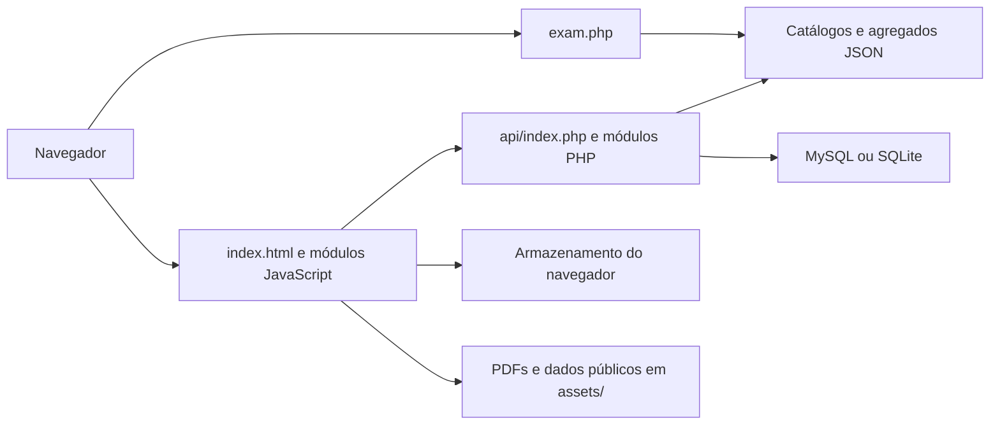

# Manual técnico do MD Strike

O MD Strike é uma plataforma de estudo de Medicina. O navegador exibe o jogo e as ferramentas de consulta. O PHP entrega páginas públicas e processa a conta, as partidas registradas e o ranking. O MySQL da Hostinger guarda o progresso vinculado à conta. O ambiente local usa SQLite.

O manual cobre a versão web **3.4.0**, publicada em 21 de novembro de 2026. A versão web aparece no parâmetro `?v=` do script principal em `index.html`. O campo `version` de `package.json` identifica o pacote de ferramentas e tem numeração própria.

## Onde começar

| Para aprender ou manter | Guia |
| --- | --- |
| Entender como a tela, a API e o servidor se comunicam | [Arquitetura e rotas](#arquitetura-e-rotas) |
| Saber o que cada uma das 12 tabelas guarda e como elas se relacionam | [Banco de dados](banco-de-dados.md) |
| Encontrar um arquivo pelo nome da função que deseja mudar | [Mapa de arquivos](arquivos.md) |
| Rodar o projeto, atualizar conteúdo, testar e publicar | [Operação e manutenção](operacao.md) |

## Tecnologias

| Tecnologia | Papel |
| --- | --- |
| HTML e CSS | Estrutura das páginas, navegação e layout responsivo |
| JavaScript modular | Interface, jogos, busca, calculadoras e comunicação com a API. Módulos carregados diretamente no navegador |
| PHP 8.2+ | Sessões, API em JSON, regras do jogo no servidor e páginas públicas renderizadas em HTML |
| SQL com PDO | Consultas, transações e criação do esquema. MySQL em produção e SQLite para desenvolvimento |
| JSON | Catálogo de provas, banco de questões, dados de referência e resultados agregados |
| Node.js e npm | Validação, empacotamento, scripts de manutenção e testes com Playwright e Chrome |
| Python | Importação de cadernos oficiais, instituições de ensino e resultados do Inep |
| PDF.js | Leitura dos cadernos de prova na própria interface |
| Apache ou LiteSpeed compatível com `.htaccess` | Rotas públicas, HTTPS e proteção de caminhos internos na Hostinger |

## Arquitetura e rotas

- **Aplicação interativa.** `index.html` carrega `assets/js/app.js`. O módulo lê o trecho após `#`, seleciona a tela e mantém o histórico de navegação. Uma rota como `/#consulta/bulas` é interpretada no navegador.
- **Páginas públicas.** Os endereços sem `#` usam reescritas de `.htaccess` na Hostinger e `scripts/router.php` no ambiente local. `exam.php` entrega o HTML, os links canônicos e o sitemap. São exemplos `/medicina/`, `/cid-10/`, `/enamed/`, `/enare/`, `/revalida/`, `/enamed/resultados/`, `/exames-medicos/`, `/consulta-clinica/` e `/codificacao-em-saude/`.
- **API.** `assets/js/core.js` faz as chamadas para `/api/index.php?action=...`. A API confere método, campos, sessão e permissões. Para operações POST, o cliente obtém um token da rota `session` e o envia no cabeçalho `X-CSRF-Token`. Isso permite ao servidor verificar que a operação saiu da sessão do site.
- **Correção registrada.** O navegador envia a alternativa selecionada. O PHP confere a questão e o gabarito, calcula a pontuação e persiste a partida e as respostas. O visitante pode jogar com o banco local do navegador. O ranking reúne resultados das contas conforme as regras públicas do jogo.

### Ações da API

| Área | Leitura por GET | Operações por POST |
| --- | --- | --- |
| Sessão e perfil | `session`, `profile` | `register`, `login`, `logout`, `update-profile`, `save-avatar`, `change-password` |
| Catálogo e partidas | `catalog`, `leaderboard` | `start-match`, `answer`, `next-question`, `abort-match` |
| Desafios por link | `challenge`, `my-challenges` | `create-challenge`, `join-challenge` |
| Simulados Revalida | `revalida-comparison` | `revalida-mark`, `revalida-submit` |
| Administração | `admin-overview`, `admin-users`, `admin-user`, `admin-matches`, `admin-challenges`, `admin-logs` | Consultas de leitura |

A lista canônica de ações aceitas e seus métodos fica em `guard_request()`. Nas alterações de contrato, confira também as chamadas no JavaScript e os testes existentes. [Validação das rotas](../app/security.php) · [Implementação da API](../api/index.php)

## Funcionalidades da versão documentada

| Área | O que existe |
| --- | --- |
| Mapas e treino | 55 mapas de especialidade, treino, revisão de erros, duelo, competitivo com bots e copa. Mapas sem banco específico oferecem treino de área-base |
| Provas médicas | 28 cadernos. Um do Enamed, 22 do Enare com pré-requisito e cinco do Revalida. O banco de exercícios tem 2.414 registros, incluindo 2.360 itens oficiais, com anulados, e 54 questões autorais de demonstração |
| Revalida | Operação com mapas por área, simulado com marcações retomáveis, correção na entrega, histórico e comparação por edição |
| Resultados do Enamed | Página pública com 351 fichas de cursos da edição de 2025, filtros, comparação e CSV agregado |
| Conta e competições | Cadastro, perfil, avatar, formação opcional, histórico, XP, ranking e desafios assíncronos por link |
| Administração | Consulta de usuários, partidas, desafios e logs de auditoria por contas autorizadas |
| Área de estudo | Resumos por disciplina, casos PBL, revisão espaçada, Trilha Enamed e curso de ECG com seis aulas |
| Consulta rápida | Protocolos, fontes brasileiras, 12 calculadoras e seis fichas de bulas com links para os documentos consultados |
| Codificação | Consulta pública de 42 códigos CID-10 e jogo de CID-10, SIGTAP e TUSS com 27 questões |
| Mapas temáticos | História da Medicina e Epônimos com dez questões cada. Medicamentos e bulas com oito |

## Exercício para aprender o sistema

1. Rode o site local e abra Consulta rápida → Bulas resumidas. Localize o caminho em `assets/js/app.js`, a montagem da tela em `assets/js/medical-resources.js` e os textos em `assets/js/medication-content.js`.
2. Abra um treino como convidado e encontre a seleção de questões em `assets/js/game.js` e a leitura do banco em `assets/js/practice-bank.js`.
3. Em uma conta de teste local, termine um treino e observe as chamadas `start-match`, `answer` e `next-question` na aba Rede do navegador. Use o guia do banco para identificar onde o resultado fica salvo.
4. Abra `/cid-10/` e compare a resposta HTML com a de `/#consulta`. Encontre o primeiro fluxo em `exam.php` e o segundo no roteador JavaScript.
