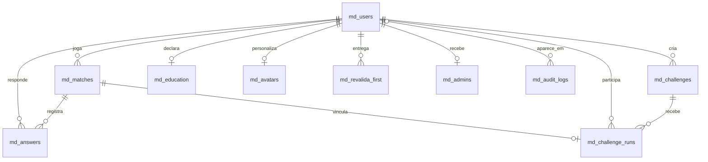

# Banco de dados do MD Strike

O código define **12 tabelas**. A mesma rotina de criação atende o MySQL da Hostinger e o SQLite local. A lista e as colunas abaixo correspondem ao esquema definido no PHP e conferido em `.runtime/mdstrike.sqlite`. A contagem física em produção pode ser conferida pela consulta de metadados ao fim do guia. [Criação das tabelas](../app/bootstrap.php)

## Inventário das 12 tabelas

| Tabela | O que guarda | Chave e restrições |
| --- | --- | --- |
| `md_users` | Contas, credenciais protegidas por hash, perfil básico e acumulados de jogo | PK `id`. `nickname` e `email` únicos |
| `md_matches` | Partidas, simulados, questões selecionadas, progresso, placar e resultado final | PK `id`. `user_id` identifica a conta |
| `md_answers` | Alternativa, acerto, pontos e tempo de cada questão respondida ou corrigida | PK `id`. Par `(match_id, question_id)` único |
| `md_challenges` | Convites por link, criador, questões compartilhadas e validade | PK `id`. `creator_id` identifica a conta criadora |
| `md_challenge_runs` | Associação entre o desafio, o participante e a partida | PK `id`. Par `(challenge_id, user_id)` único. `match_id` único |
| `md_education` | Formação opcional declarada pela conta, com instituição e localidade | PK `user_id`. Um vínculo por conta |
| `md_avatars` | Seleção de retrato e peças do avatar | PK `user_id`. Uma seleção por conta |
| `md_revalida_first` | Primeira entrega com respostas em edição com corte, declaração de formação e resultado de corte | PK composta `(user_id, exam_id)` |
| `md_admins` | Contas com acesso administrativo e data da concessão | PK `user_id` |
| `md_audit_logs` | Eventos de conta, jogo e administração, com metadados e contexto da requisição | PK `id`. Ator e sujeito podem ficar vazios |
| `md_auth_limits` | Contadores e janelas dos limites de uso da API | PK `bucket`, uma chave calculada por tipo de limite e identidade |
| `md_migrations` | Controles de migrações e de rotinas internas | PK `name` |

PK é a chave primária que identifica uma linha. As ligações do diagrama são aplicadas pelo código. O esquema atual usa chaves primárias e restrições de unicidade, com referências lógicas entre tabelas. A exclusão manual de uma conta exige avaliar todas as referências associadas.



## Dicionário de colunas

Os campos de horário usam timestamps Unix em segundos. Em SQL, campos de contagem e sinalizadores usam inteiros. Os campos de conteúdo JSON das tabelas são armazenados como texto.

### Conta, perfil e administração

| Tabela | Colunas |
| --- | --- |
| `md_users` | `id`, `nickname`, `email`, `password_hash`, `specialty`, `institution`, `status`, `xp`, `points`, `rating`, `played`, `wins`, `answered`, `correct`, `created_at`, `last_seen`, `password_changed_at` |
| `md_education` | `user_id`, `education_status`, `selection_mode`, `institution_id`, `institution_name`, `state`, `municipality_id`, `municipality_name`, `source_version`, `updated_at` |
| `md_avatars` | `user_id`, `outfit_json`, `updated_at` |
| `md_admins` | `user_id`, `granted_at` |

`md_users.institution` é o campo de perfil existente. `md_education` detalha o vínculo do seletor acadêmico e sua origem. O código trata as duas gravações na atualização do perfil em uma transação. `outfit_json` referencia IDs do catálogo de aparências. E-mail, hash e formação têm acesso restrito. [Perfil e avatar](../api/index.php) · [Formação](../app/education.php) · [Catálogo de avatar](../assets/data/avatar-catalog.json)

### Jogo, convites e Revalida

| Tabela | Colunas |
| --- | --- |
| `md_matches` | `id`, `user_id`, `mode`, `map_id`, `exam_id`, `questions_json`, `question_index`, `score`, `correct`, `bot_score`, `started_at`, `issued_at`, `finished_at`, `result_json` |
| `md_answers` | `id`, `match_id`, `user_id`, `question_id`, `area`, `map_id`, `choice`, `correct`, `points`, `elapsed`, `created_at` |
| `md_challenges` | `id`, `creator_id`, `map_id`, `questions_json`, `created_at`, `expires_at` |
| `md_challenge_runs` | `id`, `challenge_id`, `user_id`, `match_id` |
| `md_revalida_first` | `user_id`, `exam_id`, `formation`, `reached_cutoff` |

`md_matches.questions_json` guarda a seleção e a ordem das alternativas. No Revalida, também guarda as marcações até a entrega. `result_json` guarda o resultado processado pelo servidor. Em `md_answers`, `choice` é o índice da alternativa apresentada, a partir de zero, e `-1` representa ausência de resposta. `elapsed` é medido em segundos. O identificador de questão aponta para o catálogo de exercícios em JSON. A comparação pública do Revalida agrega primeiras entregas válidas de contas que declararam formação no Brasil. [Partidas](../api/index.php) · [Desafios](../app/challenges.php) · [Revalida](../app/revalida.php)

### Auditoria e manutenção

| Tabela | Colunas |
| --- | --- |
| `md_audit_logs` | `id`, `event`, `actor_id`, `subject_id`, `metadata_json`, `client_ip`, `user_agent`, `request_id`, `created_at` |
| `md_auth_limits` | `bucket`, `attempts`, `window_start` |
| `md_migrations` | `name`, `applied_at` |

A manutenção remove logs com mais de 90 dias e contadores inativos há mais de dois dias, em lotes durante o uso da API. `md_migrations` guarda marcadores de execução, inclusive o da concessão inicial de administração e o da manutenção. As sessões usam o mecanismo de sessão do PHP e um cookie. [Sessões e auditoria](../app/bootstrap.php) · [Limites e manutenção](../app/security.php)

### Índices de consulta

| Índice | Tabela e colunas |
| --- | --- |
| `md_matches_user` | `md_matches(user_id, finished_at)` |
| `md_answers_user` | `md_answers(user_id, question_id, id)` |
| `md_audit_time` | `md_audit_logs(created_at, id)` |
| `md_audit_subject` | `md_audit_logs(subject_id, id)` |
| `md_audit_actor` | `md_audit_logs(actor_id, id)` |
| `md_limits_window` | `md_auth_limits(window_start)` |

## Dados em arquivos e no navegador

| Onde | Dados |
| --- | --- |
| `app/catalog.json` e `app/questions.json` | Especialidades, edições, mapas e questões usadas pelo servidor |
| `app/enamed-results.json` | Resultados públicos do Inep agregados por curso e território |
| `app/cid10-selection.json` | Seleção da consulta pública de CID-10 |
| `app/institutions.json` e `assets/data/institutions.json` | Catálogo do seletor de instituições. O vínculo pessoal fica em `md_education` |
| `assets/js/*-content.js` e `assets/js/medical-tools.js` | Conteúdo didático, referências e fórmulas. Veja o [mapa de arquivos](arquivos.md) |
| `localStorage` do navegador | Perfil e partidas de convidado, preferências, progresso de ECG e mapas temáticos, marcações locais do Revalida, revisões de estudo e favoritos de protocolos |
| `sessionStorage` do navegador | Seleção de cursos para a comparação pública do Enamed enquanto a aba está em uso |
| Memória da página | Valores digitados nas calculadoras. As fórmulas são executadas no navegador |

As chaves de Estudo, ECG, Codificação e mapas temáticos incluem o ID da conta ou o rótulo de convidado. O progresso dessas atividades fica no navegador usado, inclusive após entrar na conta. O histórico de partidas registradas segue o fluxo da API e das tabelas de jogo. [Armazenamento no navegador](../assets/js/core.js) · [Política publicada](../assets/js/policies.js)

## Consultar a estrutura sem ler dados de pessoas

No SQLite local, abra apenas os metadados do esquema.

```sh
sqlite3 -readonly .runtime/mdstrike.sqlite "SELECT name FROM sqlite_schema WHERE type = 'table' AND substr(name, 1, 3) = 'md_' ORDER BY name;"
sqlite3 -readonly .runtime/mdstrike.sqlite ".schema md_matches"
```

No MySQL, selecione o banco do MD Strike no phpMyAdmin e rode a consulta a seguir. Cada linha é uma tabela da aplicação no banco selecionado. A consulta lê os nomes, sem acessar registros de contas.

```sql
SELECT TABLE_NAME
FROM information_schema.TABLES
WHERE TABLE_SCHEMA = DATABASE()
  AND TABLE_TYPE = 'BASE TABLE'
  AND LEFT(TABLE_NAME, 3) = 'md_'
ORDER BY TABLE_NAME;
```

O esquema é iniciado por `migrate()` ao abrir a conexão PDO. A inclusão de uma coluna em uma tabela existente precisa de uma migração explícita. Teste a criação a partir de um banco vazio e a atualização de um banco com o esquema anterior. [Criação e migração do esquema](../app/bootstrap.php)
